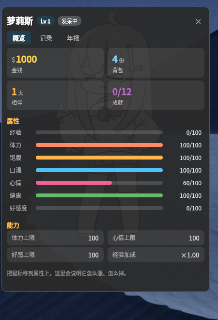
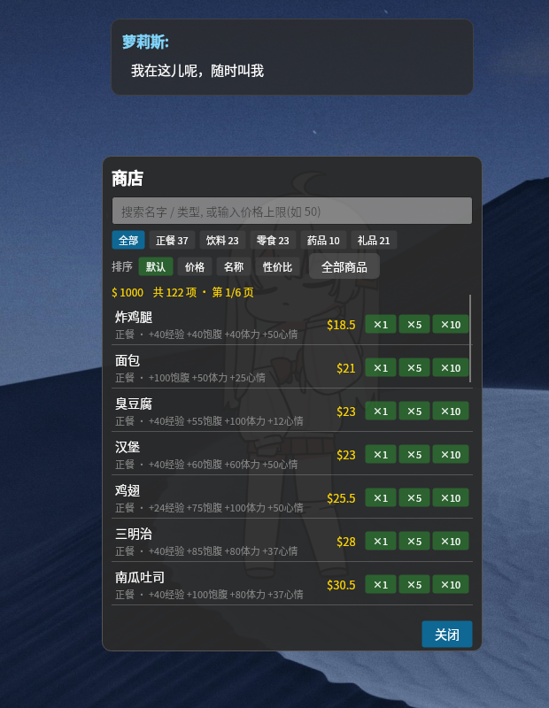
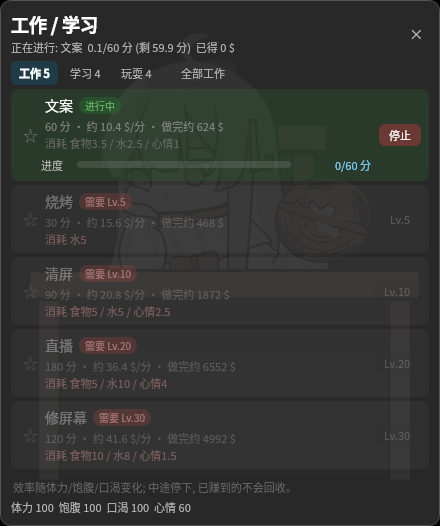
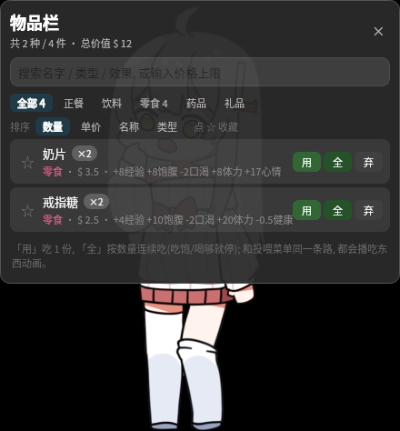
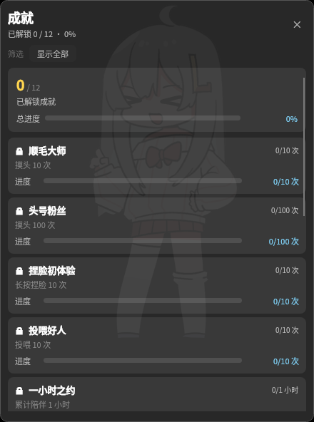
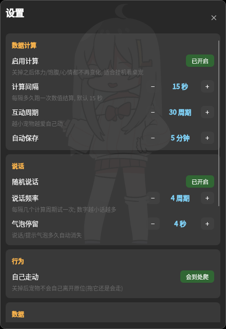

# VPet for Linux (Avalonia) — UOS / Deepin Edition

**English** · [简体中文](README.md) · [繁體中文](README.zh-TW.md) · [日本語](README.ja.md)


-green)


A Linux port of the Windows desktop pet **VPet (Virtual Pet Simulator)**, rewritten with Avalonia UI
and running on [UOS (UnionTech OS)](https://www.chinauos.com/) / Deepin.
The pet stands directly on your desktop with a transparent background and click-through.
You can drag it around, pet it, pinch its cheeks, feed it, buy it things, send it off to work, and tuck it in.

> Upstream project: [LorisYounger/VPet](https://github.com/LorisYounger/VPet). This repository contains
> only the Avalonia port layer and the Linux adaptation code, released under the same Apache-2.0 license.
> The pet artwork (MOD) is copyrighted by its original authors and is **not** included in this repository —
> see [Pet assets](#pet-assets-mod) below.

---

## Screenshots

> All six panels share the same UI language (unified in v1.5.0): card-style lists, rounded pill tabs,
> colored stat bars, and a close button always in the top-right corner.
> Screenshots taken on UOS (arm64 / Deepin desktop).

| Character | Shop | Work / Study |
|---|---|---|
|  |  |  |

| Inventory | Achievements | Settings |
|---|---|---|
|  |  |  |

---

## Features

### The pet itself

| Feature | Status |
|---------|--------|
| Transparent full-screen window, pet standing on the desktop | ✅ |
| Breathing / idle / movement animations (621 sets) | ✅ |
| **APNG** playback (fcTL/fdAT parsing + dispose/blend compositing) | ✅ |
| Drag with the left button, edge snapping on release, 1:1 pointer tracking | ✅ |
| Head pat / body pat / **long-press cheek pinch** (600 ms hold, cancelled by movement) | ✅ |
| Random speech bubbles (15 scenarios, 60+ lines, customizable) | ✅ |
| Click-through on transparent areas (X11 XShape) | ✅ |
| Always on top / move back to the bottom of the screen | ✅ |
| Right-click menu | ✅ |

### Stats and gameplay

| Feature | Status |
|---------|--------|
| Strength / mood / fullness / thirst / money / EXP / level + illness state machine | ✅ |
| **Shop**: category badges / search / four sort modes (incl. value-for-money) / bulk ×1·×5·×10 / affordable-only filter / paging | ✅ |
| **Inventory**: category filter / search / sort / ★ favorites / use (multiple at once) / discard | ✅ |
| **Feeding**: 122 foods (meals / drinks / snacks / medicine / gifts), plays eat/drink/gift animations | ✅ |
| **Work / Study / Play**: three categories, shows duration · income · cost · level requirement, greyed out when under-leveled, ★ favorites, live progress while running | ✅ |
| Sleep / wake up | ✅ |
| 12 local achievements (petting / feeding / buying / companionship / working / level / money / sleeping) | ✅ |
| Character panel: overview/records/annual tabs · 7 colored stat bars · hover hints · stat cards | ✅ |
| Settings panel: calculation toggle / interval / interaction cycle / autosave / speech frequency / bubble duration / free roaming / autostart / backup | ✅ |
| Save file read/write + autosave (5 minutes by default) | ✅ |

### Not implemented yet

- Volume / sound effects (the port has no audio subsystem)
- Theme colors
- Multiple save slots, gallery, tutorial, tray icon, localization, multiplayer
- Work schedule rotation, agent packages, work multipliers

The full gap list lives in [docs/功能对比-未实现清单.md](docs/功能对比-未实现清单.md) (Chinese).

---

## Installation

### Option 1: Download a release package (recommended, no SDK required)

Go to the [Releases](../../releases) page and download the package for your architecture:

| Package | Description |
|---|---|
| `VPet-UOS-v1.5.0-linux-x64-full.tar.gz` | Includes pet assets + .NET runtime, **ready to run after extraction** (~1.0 GB) |
| `VPet-UOS-v1.5.0-linux-arm64-full.tar.gz` | Same, for arm64 (domestic ARM machines / Kunpeng / Phytium) |
| `...-nomod.tar.gz` | Without pet assets, much smaller (~42 MB), bring your own `mod/` directory |

Not sure about your architecture? Run `uname -m`: `x86_64` → x64, `aarch64` → arm64.

```bash
tar xzf VPet-UOS-v1.5.0-linux-x64-full.tar.gz
cd VPet-UOS-v1.5.0
./scripts/install.sh            # installs to ~/.local/share/vpet and creates a desktop shortcut
```

After installation a **"VPet 桌宠"** icon appears on your desktop (the original icon is reused); double-click to launch.

> **You do not need .NET or the SDK installed.** Release packages are **self-contained**: the .NET 8 runtime
> ships inside the `publish/` directory (`includedFrameworks` in `VPet-Avalonia.App.runtimeconfig.json`),
> so offline machines and freshly installed systems work out of the box.
>
> Two details about the install script:
> - `sh install.sh` works too. If the script detects it is not running under bash it re-executes itself with
>   bash (UOS uses dash as `/bin/sh`, which does not support `pipefail` — older versions died with
>   `set: Illegal option -o pipefail`).
> - If you happen to have a **framework-dependent** package (no bundled runtime), the script searches for
>   dotnet in the usual locations and verifies that .NET 8 is present, printing install options if not.
>   You can also point it at a binary yourself: `VPET_DOTNET=/path/to/dotnet ./scripts/install.sh`.

### Option 2: Build from source

```bash
git clone <this repository> VPet-Avalonia-UOS
cd VPet-Avalonia-UOS
./scripts/build.sh          # builds into ./publish (copies pet assets from a local VPet source dir if found)
./scripts/install.sh        # installs to ~/.local/share/vpet and creates a desktop shortcut
```

You need the .NET 8 **SDK**. The build targets the **current machine's architecture** (x64 or arm64), no manual RID required.

To produce a package that runs on machines **without .NET** (what the releases contain):

```bash
./scripts/build.sh --self-contained          # current architecture, runtime bundled into publish/
VPET_RID=linux-arm64 ./scripts/build.sh --self-contained   # cross-build for arm64
```

Compile only, skip the 1 GB of assets:

```bash
./scripts/build.sh --no-mod
```

### Run manually / uninstall

```bash
~/.local/share/vpet/vpet.sh     # launch
./scripts/uninstall.sh          # uninstall
```

---

## Pet assets (MOD)

This repository does **not** ship `mod/` (roughly 1.1 GB of artwork, copyright belongs to the original authors).
Three ways to get it:

1. **Download the `full` release package** — already bundled, the easiest route;
2. Take `VPet-Simulator.Windows/mod` from the [upstream VPet](https://github.com/LorisYounger/VPet) sources or
   release package, then either build with `VPET_MOD_SRC=/path/to/mod ./scripts/build.sh` or drop the directory at
   `VPet-main/VPet-main/VPet-Simulator.Windows/mod` next to this repository (the build script finds it automatically);
3. Copy an existing `mod/` directory straight into `publish/` (or into `~/.local/share/vpet/` after installation).

---

## Interaction

- **Left-button drag**: hold and drag the pet anywhere, it snaps to the screen edge on release
- **Left click on head / body**: head pat / body pat
- **Left long-press (600 ms)**: cheek pinch
- **Right click**: menu (character panel / achievements / inventory / feed / work & study / shop / sleep·wake /
  head pat / say something / settings / always on top / click-through / back to bottom / quit)

---

## Project layout

```
VPet-Avalonia-UOS/
├── README.md                 Chinese (Simplified) README
├── README.en.md              English README (this file)
├── README.zh-TW.md           Chinese (Traditional) README
├── README.ja.md              Japanese README
├── CHANGELOG.md              Version history
├── LICENSE                   Apache-2.0 (inherited from upstream)
├── VERSION                   Current version number
├── assets/
│   ├── icon/                 Original VPet icons (png / ico / ase)
│   └── screenshots/          Real-machine verification screenshots
├── docs/
│   ├── VPet-UOS-适配说明.md      Full porting / adaptation log (24 sections, Chinese)
│   ├── VPet-Avalonia-移植进度.md Porting progress (Chinese)
│   ├── 功能对比-未实现清单.md     Original vs. port gap list (Chinese)
│   ├── 安装与排错.md            Installation and troubleshooting (Chinese)
│   ├── 发布流程.md              Release SOP (Chinese)
│   └── verify-v*.log           Self-test logs per version
├── scripts/
│   ├── build.sh              Build and publish into ./publish
│   ├── install.sh            Install to ~/.local/share/vpet + desktop shortcut
│   ├── uninstall.sh          Uninstall
│   ├── package-release.sh    Create release tar.gz archives
│   ├── release.sh            One-command release (bump > build > package > commit > tag)
│   └── vpet.sh.in            Launcher template (real paths substituted at install time)
├── packaging/
│   └── vpet.desktop          Desktop entry template
└── src/                      Avalonia port sources
    ├── VPet-Avalonia.App/              Application and window layer
    ├── VPet-Avalonia.Abstractions/     Interfaces and data models
    ├── VPet-Avalonia.Core/             Core logic
    └── VPet-Avalonia.Core.Migrated/    Ported graphics / animation / game core
```

Runtime data lives in `~/.local/share/VPet/`: `save.lps` (save file), `settings.txt`, `stats.txt`
(companionship stats), `speech.txt` (custom lines), `inventory.txt`, `achievements.txt`, `favorites.txt`,
`workfavorites.txt`.

---

## Patching and upgrading

After changing the source, rebuild and reinstall (the old directory is kept, files are overwritten):

```bash
./scripts/build.sh
VPET_SKIP_CLEAN=1 ./scripts/install.sh
```

> **Never overwrite installed files with `cp` while the app is running**: `cp` truncates the same inode, while
> the process has already `mmap`ed `Avalonia.*.dll` / `libSkiaSharp.so`, which triggers SIGBUS and leaves the pet
> as a "zombie window" that ignores clicks. `install.sh` handles this (SIGTERM first, then `rsync` with
> temporary file + rename).

---

## Known limitations

- **Click-through only works on X11 (including XWayland)**: the Wayland protocol does not let clients rewrite
  input regions, so the app automatically falls back (the window shrinks to pet size; dragging still works but
  there is no click-through).
- **Requires the .NET 8 runtime**. Release packages are self-contained (runtime bundled); builds from source are
  framework-dependent by default, add `./scripts/build.sh --self-contained` to change that.
- **No audio subsystem**, so volume / sound effect settings have no effect.
- **No Avalonia theme package is referenced**, so controls that need templates (`CheckBox`, `MenuItem`) do not
  render. That is why panel switches are tappable color pills and numbers use a `[−] value [+]` stepper —
  a design trade-off, not a bug.
- On some compositors the tray / taskbar icon is not shown (the window is a borderless always-on-top window);
  this is expected.
- On memory-constrained machines (`Committed_AS` close to `CommitLimit`) opening a large list can OOM; the shop
  already mitigates this with paging.

---

## Development notes

Pitfalls hit during the port are documented one by one in [docs/VPet-UOS-适配说明.md](docs/VPet-UOS-适配说明.md)
(Chinese). A few representative ones:

1. **Do not decide the rendering backend from `XDG_SESSION_TYPE`** — if `DISPLAY` exists (including XWayland),
   use the full X11 capabilities. Deciding by session type causes a wrong fallback: dragging breaks, panels
   overlap the pet, click-through disappears.
2. **The animation state machine must distinguish "finished naturally" from "stopped manually"**, otherwise
   replaying hangs on an already-exited loop.
3. **Any callback that touches controls must be posted to the UI thread** (Avalonia's thread check silently
   breaks the callback chain).
4. **`LPSConvert` only maps properties carrying the `[Line]` attribute** — verify field by field when porting data
   classes, a single missing field means "configured in the MOD but never read".
5. **Control count decides life or death** — 122 shop rows × 9 controls would OOM the process; paging at 12 rows
   per page brought it down to 13 controls.

Debugging environment variables:

| Variable | Purpose |
|---|---|
| `VPET_SOFTWARE_RENDER=1` | Force Skia software rendering |
| `VPET_SMALLWIN=1` | Force small-window mode |
| `VPET_SHOW_PANEL=shop\|inventory\|work\|...` | Open a given panel shortly after launch (for screenshot verification) |
| `VPET_WORK_DEMO=<name\|1>` | Automatically start the given work |
| `VPET_SELFTEST=1` | Run the full self-test |
| `VPET_SELFTEST_LIGHT=1` | Skip the cross-screen tests that always OOM on low-memory machines |

---

## License

Apache License 2.0, same as the upstream [VPet](https://github.com/LorisYounger/VPet). See [LICENSE](LICENSE).
The pet artwork (MOD) is copyrighted by its original authors and is not part of this repository.
