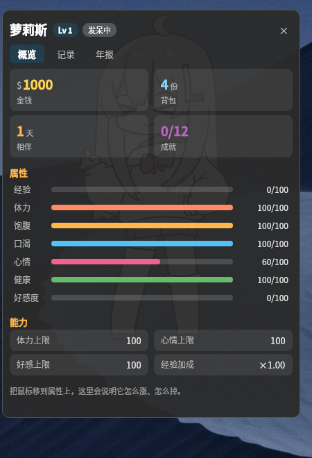
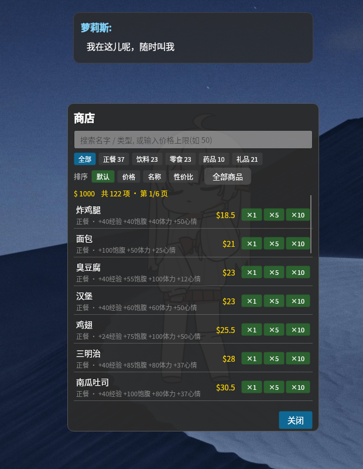
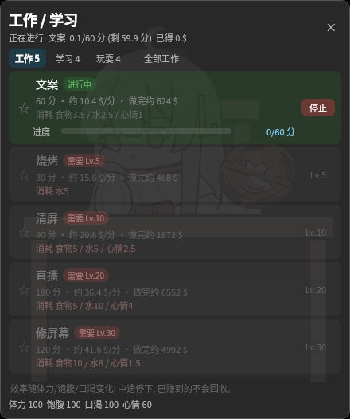
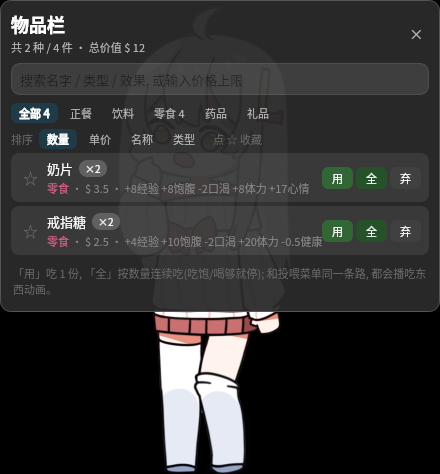
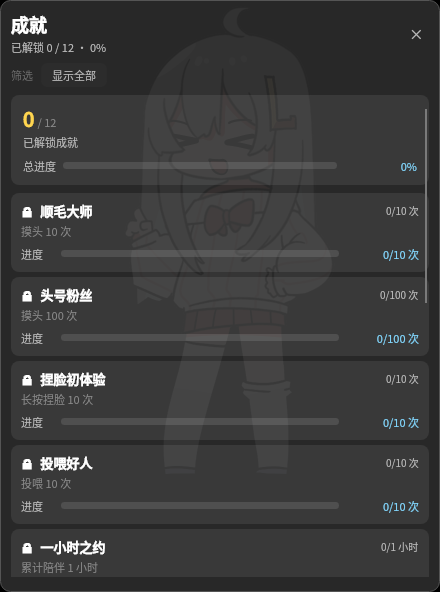
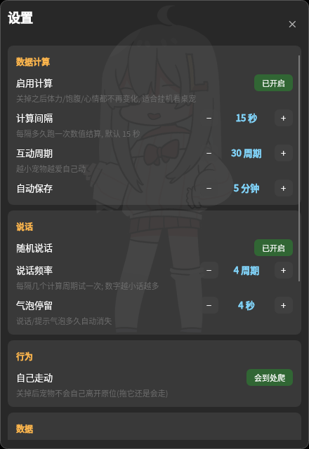

# VPet for Linux (Avalonia) — UOS / Deepin 対応版

[简体中文](README.md) · [English](README.en.md) · [繁體中文](README.zh-TW.md) · **日本語**


-green)


Windows 用デスクトップマスコット **VPet（バーチャルペットシミュレーター）** を Avalonia UI で書き直し、
Linux（統信 UOS / Deepin）で動くようにした移植版です。
ペットはデスクトップに直接立ち、背景は透明でクリックも透過します。ドラッグ、なでる、頬をつまむ、餌をあげる、
買い物、仕事、睡眠まで一通り遊べます。

> 上流プロジェクト：[LorisYounger/VPet](https://github.com/LorisYounger/VPet)。本リポジトリに含まれるのは
> Avalonia 移植レイヤーと Linux 対応コードのみで、上流と同じ Apache-2.0 ライセンスに従います。
> ペットのアート素材（MOD）の著作権は原作者に帰属し、**本リポジトリには含まれません**。
> 詳しくは下記の[ペット素材](#ペット素材mod)を参照してください。

---

## スクリーンショット

> 6 つのパネルは同じ UI 言語で統一されています（v1.5.0 で統一）：カード型リスト、角丸のピル型タブ、
> 色分けされたステータスバー、閉じるボタンは常に右上。
> スクリーンショットは統信 UOS（arm64 / Deepin デスクトップ）で撮影。

| キャラクター | ショップ | 仕事 / 勉強 |
|---|---|---|
|  |  |  |

| 持ち物 | 実績 | 設定 |
|---|---|---|
|  |  |  |

---

## 機能

### マスコット本体

| 機能 | 状態 |
|------|------|
| 透明な全画面ウィンドウ＋デスクトップ上に立つ | ✅ |
| 呼吸 / 待機 / 移動アニメーション（621 セット） | ✅ |
| **APNG 動画**の再生（fcTL/fdAT 解析＋dispose/blend 合成） | ✅ |
| 左ドラッグで移動、離すと画面端に吸着、ポインタに 1:1 追従 | ✅ |
| 頭なで / 体なで / **長押しで頬つまみ**（600ms 長押し、移動でキャンセル） | ✅ |
| ランダムな吹き出し（15 シチュエーション・60 文以上、カスタマイズ可） | ✅ |
| 透明部分のクリック透過（X11 XShape） | ✅ |
| 常に最前面 / 画面下端に戻す | ✅ |
| 右クリックメニュー | ✅ |

### ステータスと遊び

| 機能 | 状態 |
|------|------|
| 体力 / 気分 / 満腹度 / 喉の渇き / 所持金 / 経験値 / レベル＋病気ステートマシン | ✅ |
| **ショップ**：カテゴリバッジ / 検索 / 4 種類の並び替え（コスパ含む）/ まとめ買い ×1·×5·×10 / 買える物だけ表示 / ページ送り | ✅ |
| **持ち物**：カテゴリ絞り込み / 検索 / 並び替え / ★お気に入り / 使用（まとめて可）/ 捨てる | ✅ |
| **餌やり**：122 種類の食べ物（食事/飲み物/おやつ/薬/贈り物）、eat/drink/gift アニメを再生 | ✅ |
| **仕事 / 勉強 / 遊び**：3 カテゴリ、所要時間・収入・消費・必要レベルを表示、レベル不足は暗く表示、★お気に入り、実行中は進捗バー | ✅ |
| 睡眠 / 起床 | ✅ |
| ローカル実績 12 件（なでる/餌やり/購入/一緒に過ごす/仕事/レベル/お金/睡眠） | ✅ |
| キャラクターパネル：概要/記録/年間レポートの 3 タブ・7 色のステータスバー・ホバー説明・数値カード | ✅ |
| 設定パネル：計算の有効化 / 間隔 / 交流周期 / 自動保存 / 喋る頻度 / 吹き出しの表示時間 / 勝手に歩く / 自動起動 / セーブのバックアップ | ✅ |
| セーブの読み書き＋自動保存（既定 5 分） | ✅ |

### 未実装

- 音量 / 効果音（移植版に音声サブシステムがありません）
- テーマカラー
- 複数セーブの切り替え、ギャラリー、チュートリアル、トレイアイコン、多言語化、通信対戦
- 仕事スケジュールのローテーション、代理店パッケージ、仕事の倍率

差分の全リストは [docs/功能对比-未实现清单.md](docs/功能对比-未实现清单.md)（中国語）を参照。

---

## インストール

### 方法 1：リリースパッケージをダウンロード（推奨・SDK 不要）

[Releases](../../releases) ページでアーキテクチャに合ったパッケージを取得します：

| パッケージ | 内容 |
|---|---|
| `VPet-UOS-v1.5.0-linux-x64-full.tar.gz` | ペット素材＋.NET ランタイム入り、**解凍すればすぐ動く**（約 1.0 GB） |
| `VPet-UOS-v1.5.0-linux-arm64-full.tar.gz` | 同上の arm64 版（信創マシン / Kunpeng / Phytium） |
| `...-nomod.tar.gz` | ペット素材なし、軽量（約 42 MB）、`mod/` は別途用意 |

自分のアーキテクチャが分からない場合は `uname -m` を実行してください：`x86_64` なら x64、`aarch64` なら arm64 です。

```bash
tar xzf VPet-UOS-v1.5.0-linux-x64-full.tar.gz
cd VPet-UOS-v1.5.0
./scripts/install.sh            # ~/.local/share/vpet にインストールし、デスクトップにショートカットを作成
```

インストール後、デスクトップに **「VPet 桌宠」** アイコンが現れます（アイコンは原作のものを流用）。ダブルクリックで起動します。

> **.NET も SDK もインストール不要です。** リリースパッケージは**自己完結（self-contained）**で、
> .NET 8 ランタイムが `publish/` ディレクトリ内に同梱されています
> （`VPet-Avalonia.App.runtimeconfig.json` の `includedFrameworks`）。オフラインのマシンや、
> 開発環境を入れたことのない新しいシステムでもそのまま動作します。
>
> インストールスクリプトの細かい仕様：
> - `sh install.sh` でも動きます。bash 以外で起動された場合は自動で bash で再実行します
>   （UOS の `/bin/sh` は dash で `pipefail` に対応していないため、以前のバージョンは
>   `set: Illegal option -o pipefail` で落ちていました）。
> - **フレームワーク依存**パッケージ（ランタイム非同梱）の場合は、よくある場所から dotnet を探し、
>   .NET 8 があるか検証します。見つからない場合は導入手順を表示します。明示指定も可能：
>   `VPET_DOTNET=/path/to/dotnet ./scripts/install.sh`

### 方法 2：ソースからビルド

```bash
git clone <このリポジトリ> VPet-Avalonia-UOS
cd VPet-Avalonia-UOS
./scripts/build.sh          # ./publish にビルド（ローカルの VPet ソースからペット素材を自動コピー）
./scripts/install.sh        # ~/.local/share/vpet にインストールし、デスクトップにショートカットを作成
```

.NET 8 **SDK** が必要です。ビルドは**実行マシンのアーキテクチャ**（x64 / arm64）で行われ、RID の手動指定は不要です。

**.NET を入れていないマシン**で動くパッケージ（リリースと同じもの）を作る場合：

```bash
./scripts/build.sh --self-contained          # 現在のアーキテクチャで、ランタイムを publish/ に同梱
VPET_RID=linux-arm64 ./scripts/build.sh --self-contained   # arm64 向けクロスビルド
```

コンパイルだけして 1 GB の素材をコピーしない場合：

```bash
./scripts/build.sh --no-mod
```

### 手動起動 / アンインストール

```bash
~/.local/share/vpet/vpet.sh     # 起動
./scripts/uninstall.sh          # アンインストール
```

---

## ペット素材（MOD）

本リポジトリに `mod/`（約 1.1 GB のアート素材、著作権は原作者）は**含まれません**。入手方法は 3 つ：

1. **Release の full パッケージをダウンロード** —— 同梱済みで最も簡単；
2. [上流の VPet](https://github.com/LorisYounger/VPet) のソースまたは配布パッケージから
   `VPet-Simulator.Windows/mod` を取り出し、`VPET_MOD_SRC=/path/to/mod ./scripts/build.sh` で指定するか、
   リポジトリの隣の `VPet-main/VPet-main/VPet-Simulator.Windows/mod` に置く（ビルドスクリプトが自動で探します）；
3. 既存の `mod/` ディレクトリを `publish/`（インストール後なら `~/.local/share/vpet/`）に直接コピーする。

---

## 操作方法

- **左ドラッグ**：ペットを掴んで任意の位置へ。離すと画面端に吸着
- **頭 / 体を左クリック**：頭なで / 体なで
- **左長押し（600ms）**：頬つまみ
- **右クリック**：メニュー（キャラクターパネル / 実績 / 持ち物 / 餌やり / 仕事・勉強 / ショップ /
  睡眠・起床 / 頭なで / 話しかける / 設定 / 常に最前面 / クリック透過 / 画面下端に戻す / 終了）

---

## ディレクトリ構成

```
VPet-Avalonia-UOS/
├── README.md                 中国語（簡体字）
├── README.en.md              英語
├── README.zh-TW.md           中国語（繁体字）
├── README.ja.md              日本語（このファイル）
├── CHANGELOG.md              バージョン履歴
├── LICENSE                   Apache-2.0（上流を継承）
├── VERSION                   現在のバージョン番号
├── assets/
│   ├── icon/                 原作 VPet のアイコン（png / ico / ase）
│   └── screenshots/          実機検証のスクリーンショット
├── docs/
│   ├── VPet-UOS-适配说明.md      移植・対応の全記録（24 節、中国語）
│   ├── VPet-Avalonia-移植进度.md 移植進捗（中国語）
│   ├── 功能对比-未实现清单.md     原作と移植版の差分リスト（中国語）
│   ├── 安装与排错.md            インストールとトラブルシューティング（中国語）
│   ├── 发布流程.md              リリース手順（中国語）
│   └── verify-v*.log            バージョンごとの自己診断ログ
├── scripts/
│   ├── build.sh              ./publish へビルド・発行
│   ├── install.sh            ~/.local/share/vpet へインストール＋デスクトップ登録
│   ├── uninstall.sh          アンインストール
│   ├── package-release.sh    リリース用 tar.gz の作成
│   ├── release.sh            ワンコマンドリリース（版番号→ビルド→梱包→コミット→tag）
│   └── vpet.sh.in            ランチャーのテンプレート（インストール時に実パスを埋め込み）
├── packaging/
│   └── vpet.desktop          デスクトップエントリのテンプレート
└── src/                      Avalonia 移植のソース
    ├── VPet-Avalonia.App/              アプリ／ウィンドウ層
    ├── VPet-Avalonia.Abstractions/     インターフェースとデータモデル
    ├── VPet-Avalonia.Core/             コアロジック
    └── VPet-Avalonia.Core.Migrated/    移植版の描画／アニメーション／ゲームコア
```

実行時のデータは `~/.local/share/VPet/` にあります：`save.lps`（セーブ）、`settings.txt`、`stats.txt`
（一緒に過ごした記録）、`speech.txt`（カスタム台詞）、`inventory.txt`（持ち物）、`achievements.txt`、
`favorites.txt`、`workfavorites.txt`。

---

## 更新とアップグレード

ソースを変更したら、再ビルドして再インストールするだけです（既存ディレクトリは消さずに上書き）：

```bash
./scripts/build.sh
VPET_SKIP_CLEAN=1 ./scripts/install.sh
```

> **アプリの実行中に `cp` で上書きしないでください**：`cp` は同じ inode を truncate しますが、
> プロセスは `Avalonia.*.dll` / `libSkiaSharp.so` を mmap 済みのため SIGBUS が発生し、
> クリックに反応しない「ゾンビウィンドウ」になります。`install.sh` は対策済みです
> （まず SIGTERM で終了させ、`rsync` で一時ファイル＋rename）。

---

## 既知の制限

- **クリック透過は X11（XWayland 含む）でのみ有効**：Wayland プロトコルはクライアントによる入力領域の
  書き換えを許さないため、自動的に縮退します（ウィンドウはペットサイズの小窓になり、ドラッグは可能ですが
  透過しません）。
- **.NET 8 ランタイムに依存**します。Release のパッケージは自己完結（ランタイム同梱）ですが、
  ソースからのビルドは既定でフレームワーク依存です。同梱したい場合は
  `./scripts/build.sh --self-contained` を付けてください。
- **音声サブシステムがありません**。音量 / 効果音の設定は反映されません。
- **Avalonia のテーマパッケージを参照していません**。`CheckBox` / `MenuItem` のようにテンプレートを
  必要とするコントロールは描画されません。そのためパネル内のスイッチはタップ式の色付きピル、
  数値は `[−] 値 [+]` のステッパーになっています。これは設計上の割り切りで、バグではありません。
- 一部のコンポジタではトレイ / タスクバーのアイコンが表示されません（枠なしの最前面ウィンドウのため）。
  想定どおりの動作です。
- メモリの厳しいマシン（`Committed_AS` が `CommitLimit` に近い状態）で大きなリストを開くと OOM に
  なることがあります。ショップはページ送りで回避済みです。

---

## 開発メモ

移植中に踏んだ罠は [docs/VPet-UOS-适配说明.md](docs/VPet-UOS-适配说明.md)（中国語）に 1 件ずつ記録しています。
代表的なものをいくつか：

1. **`XDG_SESSION_TYPE` でレンダリングバックエンドを判断しない** —— `DISPLAY` がある（XWayland 含む）なら
   X11 の機能をフルに使うべきです。セッション種別で判断すると誤って縮退し、ドラッグが効かない、
   パネルがペットに重なる、透過しない、といった症状になります。
2. **アニメーションのステートマシンは「自然終了 Finish」と「手動停止 Stop」を区別する**。
   区別しないと、既に抜けたループに再生がぶら下がって止まります。
3. **コントロールに触るコールバックは必ず UI スレッドへ Post する**（Avalonia のスレッドチェックは
   静かにコールバック連鎖を切ります）。
4. **`LPSConvert` は `[Line]` 属性付きのプロパティしかマッピングしない** —— データクラスを移植するときは
   1 プロパティずつ確認を。1 つ漏らすと「MOD に設定したのに読めない」になります。
5. **コントロール数が生死を分ける** —— ショップ 122 行 × 9 コントロールでプロセスが OOM しました。
   1 ページ 12 件に変えて 13 コントロールまで減らしています。

デバッグ用の環境変数：

| 変数 | 効果 |
|---|---|
| `VPET_SOFTWARE_RENDER=1` | Skia のソフトウェアレンダリングを強制 |
| `VPET_SMALLWIN=1` | 小窓モードを強制 |
| `VPET_SHOW_PANEL=shop\|inventory\|work\|...` | 起動後に指定パネルを自動で開く（スクリーンショット検証用） |
| `VPET_WORK_DEMO=<名前\|1>` | 指定した仕事を自動で開始 |
| `VPET_SELFTEST=1` | 全自己診断を実行 |
| `VPET_SELFTEST_LIGHT=1` | 低メモリ環境で必ず OOM になる画面間テストを省略 |

---

## ライセンス

Apache License 2.0。上流の [VPet](https://github.com/LorisYounger/VPet) と同じです。詳細は [LICENSE](LICENSE) を参照。
ペットのアート素材（MOD）の著作権は原作者に帰属し、本リポジトリには含まれません。
