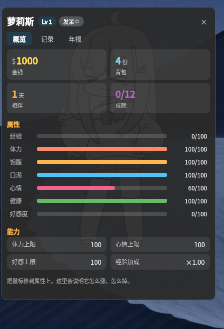
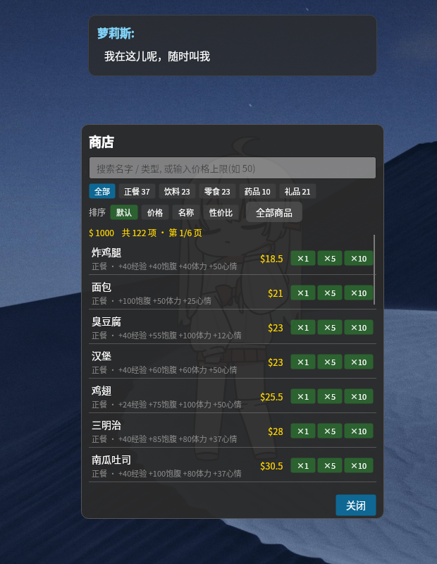
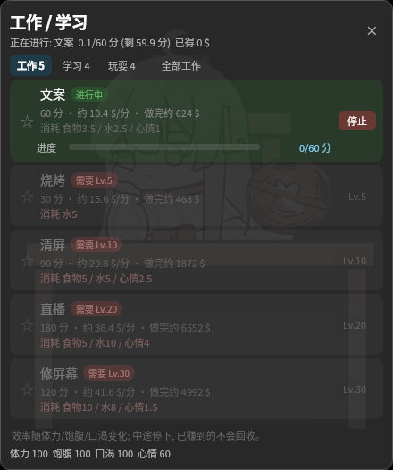

# VPet for Linux (Avalonia) — 统信 UOS / Deepin 适配版


-green)


把 Windows 桌面宠物 **VPet（虚拟桌宠模拟器）** 用 Avalonia UI 重写并在 Linux（统信 UOS / Deepin）跑起来的移植版本。
宠物直接站在桌面上，透明背景、鼠标穿透，可以拖拽、摸头捏脸、投喂、买东西、干活、睡觉。

> 上游项目：[LorisYounger/VPet](https://github.com/LorisYounger/VPet)。本仓库只包含 Avalonia 移植层与 Linux 适配代码，遵循上游的 Apache-2.0 许可证。
> 桌宠美术资源（MOD）版权归原作者，**不在本仓库内**，见下文[桌宠资源](#桌宠资源)。

---

## 截图

| 角色面板 | 商店 | 工作 / 学习 |
|---|---|---|
|  |  |  |

---

## 功能

### 桌宠本体

| 功能 | 状态 |
|------|------|
| 透明全屏窗口 + 桌面站立 | ✅ |
| 呼吸 / 待机 / 移动动画（621 组） | ✅ |
| **APNG 动图**播放（fcTL/fdAT 解析 + dispose/blend 合成） | ✅ |
| 左键拖拽移动、松手靠边吸附，指针 1:1 跟手 | ✅ |
| 摸头 / 摸身体 / **长按捏脸**（600ms 长按 + 位移取消） | ✅ |
| 随机说话气泡（15 场景 60+ 句，可自定义） | ✅ |
| 透明区域鼠标穿透（X11 XShape） | ✅ |
| 始终置顶 / 回到屏幕底部 | ✅ |
| 右键菜单 | ✅ |

### 数值与玩法

| 功能 | 状态 |
|------|------|
| 体力 / 心情 / 饱腹 / 口渴 / 金钱 / 经验 / 等级 + 生病状态机 | ✅ |
| **商店**：分类角标 / 搜索 / 四种排序（含性价比）/ 批量 ×1·×5·×10 / 只看买得起 / 分页 | ✅ |
| **物品栏**：分类过滤 / 搜索 / 排序 / ★收藏 / 使用（可连用多份）/ 丢弃 | ✅ |
| **投喂**：122 种食物（正餐/饮料/零食/药品/礼品），播 eat/drink/gift 动画 | ✅ |
| **工作 / 学习 / 玩耍**：三分类，显示时长·收益·消耗·等级要求，等级不足压暗，★收藏，进行中实时进度 | ✅ |
| 睡觉 / 唤醒 | ✅ |
| 12 条本地成就（摸头/投喂/购买/陪伴/干活/等级/金钱/睡觉） | ✅ |
| 角色面板：概览/记录/年报三页签 · 7 条彩色属性条 · 悬停说明 · 数值卡 | ✅ |
| 设置面板：数值开关 / 计算间隔 / 互动周期 / 自动保存 / 说话频率 / 气泡停留 / 自己走动 / 开机自启 / 备份存档 | ✅ |
| 存档读写 + 自动保存（默认 5 分钟） | ✅ |

### 还没做的

- 音量 / 音效（移植版没有音频子系统）
- 主题配色
- 多存档切换、图库、教程、托盘、多语言、联机
- 工作日程轮换、代理套餐、工作倍率

完整差距清单见 [docs/功能对比-未实现清单.md](docs/功能对比-未实现清单.md)。

---

## 安装

### 方式一：下载 Release 包（推荐，不用装 SDK）

到 [Releases](../../releases) 页面下载对应架构的包：

| 包 | 说明 |
|---|---|
| `VPet-UOS-v1.4.1-linux-x64-full.tar.gz` | 含桌宠资源 + .NET 运行时，**解压即用**（约 1.0 GB） |
| `VPet-UOS-v1.4.1-linux-arm64-full.tar.gz` | 同上，arm64（信创机器 / 鲲鹏 / 飞腾） |
| `...-nomod.tar.gz` | 不含桌宠资源，体积小（约 42 MB），需自备 `mod/` 目录 |

不确定自己的架构？终端里跑 `uname -m`：`x86_64` 选 x64，`aarch64` 选 arm64。

```bash
tar xzf VPet-UOS-v1.4.1-linux-x64-full.tar.gz
cd VPet-UOS-v1.4.1
./scripts/install.sh            # 安装到 ~/.local/share/vpet 并生成桌面快捷方式
```

安装后桌面上会出现 **「VPet 桌宠」** 图标（沿用原版图标），双击即可运行。

> **不需要安装 .NET，也不需要 SDK。** 发布包是**自包含（self-contained）**的：.NET 8 运行时
> 已经打在 `publish/` 目录里（`VPet-Avalonia.App.runtimeconfig.json` 里是 `includedFrameworks`），
> 所以离线机器、没装过开发环境的新装系统都能直接跑。
>
> 安装脚本的两种细节：
> - `sh install.sh` 也能用。脚本检测到不是 bash 会自动用 bash 重新执行（UOS 的 `/bin/sh` 是
>   dash，不支持 `pipefail`，早期版本会直接报 `set: Illegal option -o pipefail`）。
> - 万一你拿到的是**框架依赖**包（不含运行时），脚本会在常见位置找 dotnet 并校验有没有
>   .NET 8，找不到就打印补装方案；也可以自己指定：`VPET_DOTNET=/path/to/dotnet ./scripts/install.sh`。

### 方式二：从源码构建

```bash
git clone <本仓库地址> VPet-Avalonia-UOS
cd VPet-Avalonia-UOS
./scripts/build.sh          # 构建并发布到 ./publish（会自动从本地 VPet 源目录复制桌宠资源）
./scripts/install.sh        # 安装到 ~/.local/share/vpet 并生成桌面快捷方式
```

需要 .NET 8 **SDK**。构建按**当前机器架构**产出（x64 / arm64 均可），不需要手动指定 RID。

想打出**目标机不用装 .NET** 的包（就是 Release 里那种）：

```bash
./scripts/build.sh --self-contained          # 按本机架构，把运行时打进 publish/
VPET_RID=linux-arm64 ./scripts/build.sh --self-contained   # 交叉出 arm64
```

只想编译、不复制 1 GB 资源：

```bash
./scripts/build.sh --no-mod
```

### 手动运行 / 卸载

```bash
~/.local/share/vpet/vpet.sh     # 启动
./scripts/uninstall.sh          # 卸载
```

---

## 桌宠资源

仓库里**不含** `mod/`（约 1.1 GB 的美术资源，版权归原作者）。三种获取方式：

1. **下 Release 的 full 包** —— 已经打包好，最省事；
2. 从[上游 VPet](https://github.com/LorisYounger/VPet) 源码或发行包里取 `VPet-Simulator.Windows/mod`，
   构建时用 `VPET_MOD_SRC=/path/to/mod ./scripts/build.sh` 指定，或直接把该目录放到仓库旁的
   `VPet-main/VPet-main/VPet-Simulator.Windows/mod`（构建脚本会自动找）；
3. 把已有的 `mod/` 目录直接放进 `publish/`（或安装后的 `~/.local/share/vpet/`）。

---

## 交互方式

- **左键拖拽**：按住宠物拖到任意位置，松手后靠边吸附
- **左键点击头部 / 身体**：摸头 / 摸身体
- **左键长按（600ms）**：捏脸
- **右键**：菜单（角色面板 / 成就 / 物品栏 / 投喂 / 工作学习 / 商店 / 睡觉·唤醒 / 摸摸头 / 说说话 / 设置 / 始终置顶 / 鼠标穿透 / 回到屏幕底部 / 退出）

---

## 目录结构

```
VPet-Avalonia-UOS/
├── README.md                 本文件
├── CHANGELOG.md              版本记录
├── LICENSE                   Apache-2.0（沿用上游）
├── VERSION                   当前版本号
├── assets/
│   ├── icon/                 原版 VPet 图标（png / ico / ase）
│   └── screenshots/          实机验证截图
├── docs/
│   ├── VPet-UOS-适配说明.md      完整的移植与适配记录（按轮次，24 节）
│   ├── VPet-Avalonia-移植进度.md
│   ├── 功能对比-未实现清单.md     原版 vs 移植版差距清单
│   ├── 安装与排错.md
│   ├── 发布流程.md            发版 SOP（改版本→构建→打包→推送→发 Release）
│   └── verify-v*.log            各版本自检日志
├── scripts/
│   ├── build.sh              构建并发布到 ./publish
│   ├── install.sh            安装到 ~/.local/share/vpet + 桌面快捷方式
│   ├── uninstall.sh          卸载
│   ├── package-release.sh    打 Release 用的 tar.gz
│   ├── release.sh            一键发版（改版本→构建→打包→提交→tag）
│   └── vpet.sh.in            启动器模板（安装时生成真实路径）
├── packaging/
│   └── vpet.desktop          桌面快捷方式模板
└── src/                      Avalonia 移植源码
    ├── VPet-Avalonia.App/              应用与窗口层
    ├── VPet-Avalonia.Abstractions/     接口与数据模型
    ├── VPet-Avalonia.Core/             核心逻辑
    └── VPet-Avalonia.Core.Migrated/    移植版图形/动画/游戏核心
```

运行时数据在 `~/.local/share/VPet/`：`save.lps`（存档）、`settings.txt`、`stats.txt`（陪伴统计）、
`speech.txt`（自定义台词）、`inventory.txt`（背包）、`achievements.txt`、`favorites.txt`、`workfavorites.txt`。

---

## 补丁与升级

改完源码后重新构建并安装即可（不清空旧目录，只覆盖）：

```bash
./scripts/build.sh
VPET_SKIP_CLEAN=1 ./scripts/install.sh
```

> **不要在程序运行时用 `cp` 覆盖安装文件**：`cp` 会 truncate 同一个 inode，而进程已 mmap 了
> `Avalonia.*.dll` / `libSkiaSharp.so`，会触发 SIGBUS 让桌宠变成点不动的「僵尸窗口」。
> `install.sh` 已处理（先 SIGTERM 结束进程，再用 `rsync` 走临时文件 + rename）。

---

## 已知限制

- **鼠标穿透只在 X11（含 XWayland）下可用**：Wayland 协议不允许客户端改写输入区域，程序会自动降级
  （此时窗口为宠物大小的小窗，拖拽仍可用但无穿透）。
- **依赖 .NET 8 运行时**。Release 里的包是自包含的（运行时已内置），从源码构建时默认是框架依赖，
  想免依赖加 `./scripts/build.sh --self-contained`。
- **没有音频子系统**，音量 / 音效设置项不生效。
- **没有引入 Avalonia 主题包**，`CheckBox` / `MenuItem` 这类需要模板的控件不渲染，
  所以面板里的开关是点击式色块、数值用 `[−] 值 [+]` 步进器 —— 这是设计取舍不是 bug。
- 部分合成器下托盘 / 任务栏图标不显示（窗口是无边框置顶窗口），属预期行为。
- 内存受限的机器（`Committed_AS` 接近 `CommitLimit`）上打开大列表可能 OOM，商店已做分页规避。

---

## 开发说明

移植过程中踩到的坑逐条记在 [docs/VPet-UOS-适配说明.md](docs/VPet-UOS-适配说明.md)，几条比较典型的：

1. **不要按 `XDG_SESSION_TYPE` 判断渲染后端** —— 有 `DISPLAY`（含 XWayland）就该走完整 X11 能力，
   按会话类型判断会误降级，导致拖动失效、面板叠宠物、无穿透。
2. **动画状态机要区分「自然结束 Finish」与「手动停止 Stop」**，否则重播会挂在已退出的循环上。
3. **所有碰控件的回调必须 Post 到 UI 线程**（Avalonia 线程检查会静默断掉回调链）。
4. **`LPSConvert` 只映射带 `[Line]` 特性的属性** —— 移植数据类要逐属性核对，漏一个字段就是
   「MOD 里配了但读不到」。
5. **控件数量直接决定生死** —— 商店 122 行 × 9 控件会让进程 OOM，改每页 12 条后降到 13 个控件。

调试用环境变量：

| 变量 | 作用 |
|---|---|
| `VPET_SOFTWARE_RENDER=1` | 强制 Skia 软件渲染 |
| `VPET_SMALLWIN=1` | 强制小窗模式 |
| `VPET_SHOW_PANEL=shop\|inventory\|work\|...` | 启动后自动打开指定面板（配合截屏核对布局） |
| `VPET_WORK_DEMO=<名称\|1>` | 自动开始指定工作 |
| `VPET_SELFTEST=1` | 跑全量自检 |
| `VPET_SELFTEST_LIGHT=1` | 跳过低内存机器上必 OOM 的跨屏项 |

---

## 许可证

Apache License 2.0，与上游 [VPet](https://github.com/LorisYounger/VPet) 一致，详见 [LICENSE](LICENSE)。
桌宠美术资源（MOD）版权归原作者所有，不在本仓库内。
