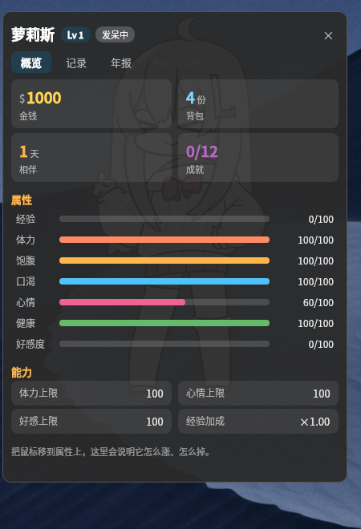
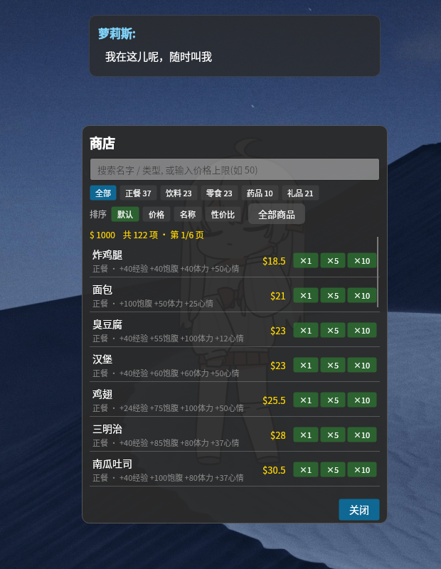
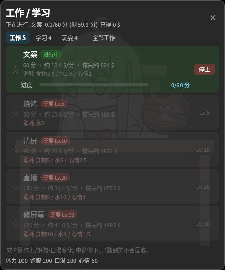
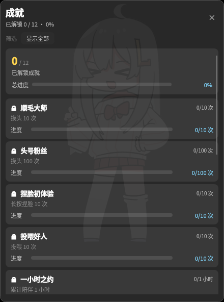

# VPet for Linux (Avalonia) — 統信 UOS / Deepin 適配版

[简体中文](README.md) · [English](README.en.md) · **繁體中文** · [日本語](README.ja.md)


-green)


把 Windows 桌面寵物 **VPet（虛擬桌寵模擬器）** 用 Avalonia UI 重寫、並在 Linux（統信 UOS / Deepin）上跑起來的移植版本。
寵物直接站在桌面上，背景透明、滑鼠可穿透，可以拖曳、摸頭捏臉、餵食、買東西、幹活、睡覺。

> 上游專案：[LorisYounger/VPet](https://github.com/LorisYounger/VPet)。本儲存庫只包含 Avalonia 移植層與 Linux 適配程式碼，
> 遵循上游的 Apache-2.0 授權條款。
> 桌寵美術資源（MOD）版權歸原作者所有，**不在本儲存庫內**，詳見下文[桌寵資源](#桌寵資源)。

---

## 截圖

> 六個面板共用同一套介面語言（v1.5.0 統一）：卡片式清單、圓角膠囊頁籤、彩色屬性條，
> 關閉入口統一在右上角。截圖取自統信 UOS（arm64 / Deepin 桌面）。

| 角色面板 | 商店 | 工作 / 學習 |
|---|---|---|
|  |  |  |

| 物品欄 | 成就 | 設定 |
|---|---|---|
|  |  |  |

---

## 功能

### 桌寵本體

| 功能 | 狀態 |
|------|------|
| 透明全螢幕視窗 + 桌面站立 | ✅ |
| 呼吸 / 待機 / 移動動畫（621 組） | ✅ |
| **APNG 動圖**播放（fcTL/fdAT 解析 + dispose/blend 合成） | ✅ |
| 左鍵拖曳移動、放開後靠邊吸附，指標 1:1 跟手 | ✅ |
| 摸頭 / 摸身體 / **長按捏臉**（600ms 長按 + 位移取消） | ✅ |
| 隨機說話氣泡（15 場景 60+ 句，可自訂） | ✅ |
| 透明區域滑鼠穿透（X11 XShape） | ✅ |
| 始終置頂 / 回到螢幕底部 | ✅ |
| 右鍵選單 | ✅ |

### 數值與玩法

| 功能 | 狀態 |
|------|------|
| 體力 / 心情 / 飽足 / 口渴 / 金錢 / 經驗 / 等級 + 生病狀態機 | ✅ |
| **商店**：分類角標 / 搜尋 / 四種排序（含性價比）/ 批次 ×1·×5·×10 / 只看買得起 / 分頁 | ✅ |
| **物品欄**：分類過濾 / 搜尋 / 排序 / ★收藏 / 使用（可連用多份）/ 丟棄 | ✅ |
| **餵食**：122 種食物（正餐/飲料/零食/藥品/禮品），播放 eat/drink/gift 動畫 | ✅ |
| **工作 / 學習 / 玩耍**：三分類，顯示時長·收益·消耗·等級要求，等級不足壓暗，★收藏，進行中即時進度 | ✅ |
| 睡覺 / 喚醒 | ✅ |
| 12 條本機成就（摸頭/餵食/購買/陪伴/幹活/等級/金錢/睡覺） | ✅ |
| 角色面板：概覽/紀錄/年報三頁籤 · 7 條彩色屬性條 · 懸停說明 · 數值卡 | ✅ |
| 設定面板：數值開關 / 計算間隔 / 互動週期 / 自動存檔 / 說話頻率 / 氣泡停留 / 自己走動 / 開機自啟 / 備份存檔 | ✅ |
| 存檔讀寫 + 自動存檔（預設 5 分鐘） | ✅ |

### 還沒做的

- 音量 / 音效（移植版沒有音訊子系統）
- 主題配色
- 多存檔切換、圖庫、教學、系統匣、多語言、連線
- 工作排程輪換、代理套餐、工作倍率

完整差距清單見 [docs/功能对比-未实现清单.md](docs/功能对比-未实现清单.md)（簡體中文）。

---

## 安裝

### 方式一：下載 Release 套件（推薦，不用裝 SDK）

到 [Releases](../../releases) 頁面下載對應架構的套件：

| 套件 | 說明 |
|---|---|
| `VPet-UOS-v1.5.0-linux-x64-full.tar.gz` | 含桌寵資源 + .NET 執行階段，**解壓即用**（約 1.0 GB） |
| `VPet-UOS-v1.5.0-linux-arm64-full.tar.gz` | 同上，arm64（信創機器 / 鯤鵬 / 飛騰） |
| `...-nomod.tar.gz` | 不含桌寵資源，體積小（約 42 MB），需自備 `mod/` 目錄 |

不確定自己的架構？終端機裡跑 `uname -m`：`x86_64` 選 x64，`aarch64` 選 arm64。

```bash
tar xzf VPet-UOS-v1.5.0-linux-x64-full.tar.gz
cd VPet-UOS-v1.5.0
./scripts/install.sh            # 安裝到 ~/.local/share/vpet 並產生桌面捷徑
```

安裝後桌面上會出現 **「VPet 桌宠」** 圖示（沿用原版圖示），雙擊即可執行。

> **不需要安裝 .NET，也不需要 SDK。** 發佈包是**自包含（self-contained）**的：.NET 8 執行階段
> 已經打在 `publish/` 目錄裡（`VPet-Avalonia.App.runtimeconfig.json` 裡是 `includedFrameworks`），
> 所以離線機器、沒裝過開發環境的新系統都能直接跑。
>
> 安裝腳本的兩個細節：
> - `sh install.sh` 也能用。腳本偵測到不是 bash 會自動用 bash 重新執行（UOS 的 `/bin/sh` 是
>   dash，不支援 `pipefail`，早期版本會直接報 `set: Illegal option -o pipefail`）。
> - 萬一你拿到的是**框架相依**套件（不含執行階段），腳本會在常見位置找 dotnet 並檢查有沒有
>   .NET 8，找不到就列出補裝方案；也可以自己指定：`VPET_DOTNET=/path/to/dotnet ./scripts/install.sh`。

### 方式二：從原始碼建置

```bash
git clone <本儲存庫位址> VPet-Avalonia-UOS
cd VPet-Avalonia-UOS
./scripts/build.sh          # 建置並發佈到 ./publish（會自動從本機 VPet 來源目錄複製桌寵資源）
./scripts/install.sh        # 安裝到 ~/.local/share/vpet 並產生桌面捷徑
```

需要 .NET 8 **SDK**。建置按**目前機器架構**產出（x64 / arm64 皆可），不需要手動指定 RID。

想打出**目標機不用裝 .NET** 的套件（就是 Release 裡那種）：

```bash
./scripts/build.sh --self-contained          # 按本機架構，把執行階段打進 publish/
VPET_RID=linux-arm64 ./scripts/build.sh --self-contained   # 交叉產出 arm64
```

只想編譯、不複製 1 GB 資源：

```bash
./scripts/build.sh --no-mod
```

### 手動執行 / 解除安裝

```bash
~/.local/share/vpet/vpet.sh     # 啟動
./scripts/uninstall.sh          # 解除安裝
```

---

## 桌寵資源

儲存庫裡**不含** `mod/`（約 1.1 GB 的美術資源，版權歸原作者）。三種取得方式：

1. **下 Release 的 full 套件** —— 已經打包好，最省事；
2. 從[上游 VPet](https://github.com/LorisYounger/VPet) 原始碼或發行包裡取 `VPet-Simulator.Windows/mod`，
   建置時用 `VPET_MOD_SRC=/path/to/mod ./scripts/build.sh` 指定，或直接把該目錄放到儲存庫旁的
   `VPet-main/VPet-main/VPet-Simulator.Windows/mod`（建置腳本會自動找）；
3. 把既有的 `mod/` 目錄直接放進 `publish/`（或安裝後的 `~/.local/share/vpet/`）。

---

## 互動方式

- **左鍵拖曳**：按住寵物拖到任意位置，放開後靠邊吸附
- **左鍵點擊頭部 / 身體**：摸頭 / 摸身體
- **左鍵長按（600ms）**：捏臉
- **右鍵**：選單（角色面板 / 成就 / 物品欄 / 餵食 / 工作學習 / 商店 / 睡覺·喚醒 / 摸摸頭 / 說說話 / 設定 / 始終置頂 / 滑鼠穿透 / 回到螢幕底部 / 離開）

---

## 目錄結構

```
VPet-Avalonia-UOS/
├── README.md                 簡體中文說明
├── README.en.md              英文說明
├── README.zh-TW.md           繁體中文說明（本檔）
├── README.ja.md              日文說明
├── CHANGELOG.md              版本紀錄
├── LICENSE                   Apache-2.0（沿用上游）
├── VERSION                   目前版本號
├── assets/
│   ├── icon/                 原版 VPet 圖示（png / ico / ase）
│   └── screenshots/          實機驗證截圖
├── docs/
│   ├── VPet-UOS-适配说明.md      完整的移植與適配紀錄（按輪次，24 節）
│   ├── VPet-Avalonia-移植进度.md
│   ├── 功能对比-未实现清单.md     原版 vs 移植版差距清單
│   ├── 安装与排错.md           安裝與排錯
│   ├── 发布流程.md            發版 SOP（改版本→建置→打包→推送→發 Release）
│   └── verify-v*.log            各版本自檢日誌
├── scripts/
│   ├── build.sh              建置並發佈到 ./publish
│   ├── install.sh            安裝到 ~/.local/share/vpet + 桌面捷徑
│   ├── uninstall.sh          解除安裝
│   ├── package-release.sh    打 Release 用的 tar.gz
│   ├── release.sh            一鍵發版（改版本→建置→打包→提交→tag）
│   └── vpet.sh.in            啟動器範本（安裝時產生真實路徑）
├── packaging/
│   └── vpet.desktop          桌面捷徑範本
└── src/                      Avalonia 移植原始碼
    ├── VPet-Avalonia.App/              應用與視窗層
    ├── VPet-Avalonia.Abstractions/     介面與資料模型
    ├── VPet-Avalonia.Core/             核心邏輯
    └── VPet-Avalonia.Core.Migrated/    移植版圖形/動畫/遊戲核心
```

執行階段資料在 `~/.local/share/VPet/`：`save.lps`（存檔）、`settings.txt`、`stats.txt`（陪伴統計）、
`speech.txt`（自訂台詞）、`inventory.txt`（背包）、`achievements.txt`、`favorites.txt`、`workfavorites.txt`。

---

## 修補與升級

改完原始碼後重新建置並安裝即可（不清空舊目錄，只覆蓋）：

```bash
./scripts/build.sh
VPET_SKIP_CLEAN=1 ./scripts/install.sh
```

> **不要在程式執行時用 `cp` 覆蓋安裝檔案**：`cp` 會 truncate 同一個 inode，而行程已 mmap 了
> `Avalonia.*.dll` / `libSkiaSharp.so`，會觸發 SIGBUS 讓桌寵變成點不動的「殭屍視窗」。
> `install.sh` 已處理（先 SIGTERM 結束行程，再用 `rsync` 走暫存檔 + rename）。

---

## 已知限制

- **滑鼠穿透只在 X11（含 XWayland）下可用**：Wayland 協定不允許客戶端改寫輸入區域，程式會自動降級
  （此時視窗為寵物大小的小視窗，拖曳仍可用但無穿透）。
- **相依 .NET 8 執行階段**。Release 裡的套件是自包含的（執行階段已內建），從原始碼建置時預設是框架相依，
  想免相依加 `./scripts/build.sh --self-contained`。
- **沒有音訊子系統**，音量 / 音效設定項不生效。
- **沒有引入 Avalonia 主題套件**，`CheckBox` / `MenuItem` 這類需要範本的控件不渲染，
  所以面板裡的開關是點擊式色塊、數值用 `[−] 值 [+]` 步進器 —— 這是設計取捨不是 bug。
- 部分合成器下系統匣 / 工作列圖示不顯示（視窗是無邊框置頂視窗），屬預期行為。
- 記憶體受限的機器（`Committed_AS` 接近 `CommitLimit`）上開啟大清單可能 OOM，商店已做分頁規避。

---

## 開發說明

移植過程中踩到的坑逐條記在 [docs/VPet-UOS-适配说明.md](docs/VPet-UOS-适配说明.md)，幾條比較典型的：

1. **不要按 `XDG_SESSION_TYPE` 判斷渲染後端** —— 有 `DISPLAY`（含 XWayland）就該走完整 X11 能力，
   按工作階段類型判斷會誤降級，導致拖曳失效、面板疊寵物、無穿透。
2. **動畫狀態機要區分「自然結束 Finish」與「手動停止 Stop」**，否則重播會掛在已退出的迴圈上。
3. **所有碰控件的回呼必須 Post 到 UI 執行緒**（Avalonia 的執行緒檢查會靜默斷掉回呼鏈）。
4. **`LPSConvert` 只映射帶 `[Line]` 特性的屬性** —— 移植資料類別要逐屬性核對，漏一個欄位就是
   「MOD 裡配了但讀不到」。
5. **控件數量直接決定生死** —— 商店 122 列 × 9 控件會讓行程 OOM，改每頁 12 條後降到 13 個控件。

除錯用環境變數：

| 變數 | 作用 |
|---|---|
| `VPET_SOFTWARE_RENDER=1` | 強制 Skia 軟體渲染 |
| `VPET_SMALLWIN=1` | 強制小視窗模式 |
| `VPET_SHOW_PANEL=shop\|inventory\|work\|...` | 啟動後自動開啟指定面板（配合截圖核對版面） |
| `VPET_WORK_DEMO=<名稱\|1>` | 自動開始指定工作 |
| `VPET_SELFTEST=1` | 跑全部自檢 |
| `VPET_SELFTEST_LIGHT=1` | 跳過低記憶體機器上必 OOM 的跨螢幕項目 |

---

## 授權條款

Apache License 2.0，與上游 [VPet](https://github.com/LorisYounger/VPet) 一致，詳見 [LICENSE](LICENSE)。
桌寵美術資源（MOD）版權歸原作者所有，不在本儲存庫內。
